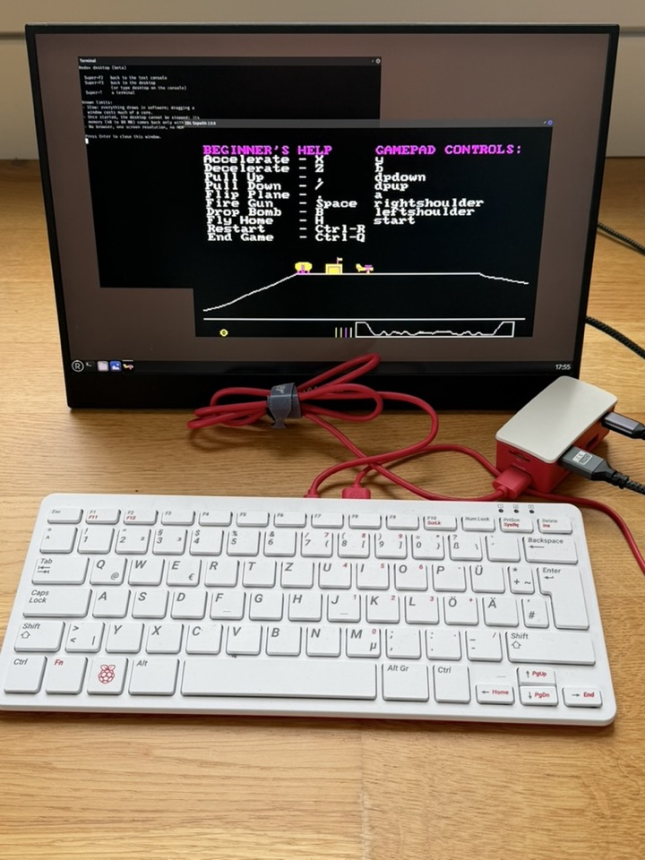

## Redox OS on the Raspberry Pi

We bring [Redox OS](https://www.redox-os.org/) to the Raspberry Pi.
Redox is a young operating system written in Rust: small, safe, and built
from the ground up, with every driver running as a normal program.

**Our goal:** Redox runs on (almost) every Raspberry Pi from the Zero 2 W
upwards, from a small headless server to a desktop with a screen,
keyboard, mouse and sound.

  
   <em>Redox on a Raspberry Pi 3B+: the optional desktop, a terminal and a game with sound.</em>

### What works today

A Raspberry Pi 3B+ or Zero 2 W boots Redox from an SD card or over the
network. You get a console on the screen and over the serial port, USB
keyboard and mouse, wired network, the correct time from the internet,
sound from the headphone jack, the pin header (GPIO, I2C, SPI), and an
optional desktop. A small C compiler runs on the Pi itself.

It is still experimental: fun to try and to work on, not for daily use.
We release a new version every week.

**Next:** sound over HDMI, Wi-Fi, the Pi 4 and Pi 400, later the Pi 5.

### Try it

1. Download the image of the [latest release](https://github.com/redox-rpi/redox-rpi/releases/latest).
2. Write it to a microSD card, for example with the Raspberry Pi Imager
   ("Use custom") or balenaEtcher.
3. Put the card into a Pi 3B+ or Zero 2 W, connect a screen and a keyboard,
   and switch it on.

No Pi at hand? Redox also starts in an emulator on macOS or Linux; see
[getting started](https://github.com/redox-rpi/redox-rpi/blob/main/docs/getting-started.md).

### Learn more

- [Wiki](https://github.com/redox-rpi/redox-rpi/wiki): the Raspberry Pi boards and how they work
- [Releases](https://github.com/redox-rpi/redox-rpi/releases) and
  [known issues](https://github.com/redox-rpi/redox-rpi/blob/main/docs/known-issues.md)
- Side projects around the Pi's graphics chip
  ([how they fit together](https://github.com/redox-rpi/redox-rpi/wiki/VideoCore-IV)):
  our own open boot firmware
  ([rpi-open-firmware](https://github.com/redox-rpi/rpi-open-firmware)), a display driver
  ([vc4d](https://github.com/redox-rpi/vc4d)) and a small compiler for the Pi's
  graphics processor ([tinycc](https://github.com/redox-rpi/tinycc))
- All repositories: [github.com/redox-rpi](https://github.com/orgs/redox-rpi/repositories)

### Join us

People and AI agents are welcome, whether you have a Pi on your desk or
not. Pick an issue, say that you take it, and open a pull request; the
same rules apply to everyone.

- [How to join](https://github.com/redox-rpi/redox-rpi/blob/main/docs/join.md)
  and [how we work](https://github.com/redox-rpi/redox-rpi/blob/main/CONTRIBUTING.md)
- Issues that need no hardware:
  [needs:nothing](https://github.com/redox-rpi/redox-rpi/issues?q=is%3Aopen+label%3Aneeds%3Anothing)
- Questions and ideas: [Discussions](https://github.com/redox-rpi/redox-rpi/discussions)
  · chat on Matrix: [#redox-rpi:matrix.org](https://matrix.to/#/#redox-rpi:matrix.org)

### About this project

This is an **unofficial fork**, not part of the Redox OS project. One
maintainer builds it together with a team of AI coding agents, which Redox
does not accept upstream, so please report problems here and not to Redox.
Our own code is MIT-licensed like Redox; forks keep the licence of their
original.
